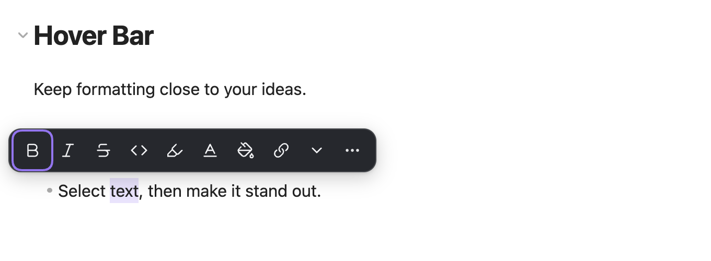

# Hover Bar

A lightweight, offline selection toolbar for formatting text in desktop Obsidian.

[简体中文](README.zh-CN.md)

## What it is for

Select a phrase, make it bold, highlight an idea, give a term a color, or turn it into an internal link. Keep these small editing tasks close to the text you are working on.

The toolbar appears when you finish selecting text. Ordinary formatting stays in Markdown; custom text and background colors use small inline HTML spans.

## Features

- A compact floating toolbar near your selection on desktop, with viewport-aware placement.
- Pin and reorder common actions per vault; unpinned actions and actions that do not fit stay available in **More**.
- Bold, italic, strikethrough, inline code, and standard Obsidian highlights.
- Named text and background colors, custom HEX input with a preview, and separate recent-color lists per vault.
- Quick `[[internal links]]` and a picker for existing notes.
- Undo and redo through the editor's normal history.
- Light and dark theme support and keyboard navigation.
- Chinese text when Obsidian uses a Chinese language setting; English for every other language.
- Controls to disable automatic display while keeping a command to open the toolbar.
- Specific feedback for read-only editors, disabled modes, multiple selections, line breaks, formatting conflicts, and length limits.

## How to use

1. Open a Markdown note in Live Preview or Source mode.
2. Select a plain-text phrase using your mouse or trackpad.
3. Click a formatting button, or open a color palette and choose a color.

Click outside the toolbar or press Esc to close it. For keyboard access, use **Show selection toolbar** in the command palette. You can assign your own hotkey in Obsidian's hotkey settings.

| Action | Example saved in your note |
| --- | --- |
| Bold | `**Important**` |
| Strikethrough | `~~Outdated~~` |
| Highlight | `==Remember this==` |
| Text color | `Important` |
| Background color | `Remember this` |
| Internal link | `[[Concept]]` |

## Compatibility and limitations

Requires desktop Obsidian **1.8.7 or later**, in Live Preview or Source mode. Mobile devices are not supported. Reading view does not show the toolbar.

Use a single text fragment within one logical line, including text in a heading, list item, or blockquote. Keep structural markers outside your selection. Complex mixed formatting, partial HTML spans, multiple selections, tables, code blocks, math, and frontmatter will not be rewritten. Unsupported actions explain their limitation.

Automatic selection quietly skips unsupported content. Open the toolbar manually or activate an unavailable action to learn why. Length protection checks the original selection, its full line, and the resulting line before writing. Select less text or split an overly long paragraph when needed.

Custom colors are saved as inline HTML. They remain in the note after disabling the plugin, but their appearance depends on the renderer and theme. Export tools may strip styles. Source mode shows the underlying markup, and Live Preview may reveal it while editing. The internal-link action intentionally writes wikilinks.

## Custom and recent colors

Open **Text color** or **Background color**. Choose a preset, reuse a recent color, or enter `#RGB` or `#RRGGBB` under **Custom color** and select **Apply color**. Short and uppercase values become lowercase six-digit HEX, such as `#abc` → `#aabbcc`. The preview changes only the panel until you apply. Other CSS expressions, alpha colors and gradients are not supported.

Each palette remembers its last five successfully applied colors, newest first. Reusing a color takes two activations from a main-toolbar color entry, or three when the entry is in **More**. Applying the same color to already-colored text is a no-op and does not reorder history. Removing colors or undoing an edit does not erase recent colors. Use **Default text color**, **Remove background color**, or **Remove all colors** to change the note.

If recent colors cannot be saved, the note edit still succeeds and you can continue formatting. Retry in **Settings → Hover Bar → Recent colors**. A history-only external conflict pauses saves and preference changes while editing remains available. **Reload recent colors** discards history unsaved before reload starts; colors successfully applied during reload are retained. **Clear recent colors** clears both lists without changing notes or other preferences.

Colors retain their exact values in both themes; choose readable combinations. Arbitrary hand-written HTML styles remain outside the supported editing syntax. Version 0.1.5 upgrades plugin data to schema 3 on the next explicit change or successful color use. Older plugin versions reject it and disable the toolbar; back up the plugin's `data.json` before upgrading if you need to restore older preferences when downgrading. Notes do not need conversion.

## Installation

Hover Bar is not listed in the community directory yet. Install the packaged plugin from [GitHub Releases](https://github.com/saltcoffee/hover-bar/releases/latest):

1. Download `main.js`, `manifest.json`, and `styles.css` from the release assets.
2. Create a `hover-bar` folder inside your vault's `.obsidian/plugins/` folder and copy the three files into it.
3. Restart Obsidian and enable **Hover Bar** in **Settings → Community plugins**.

When Hover Bar is available in the community directory:

1. Open **Settings → Community plugins** in Obsidian.
2. Select **Browse** and search for **Hover Bar**.
3. Select **Install**, then **Enable**.

## Preferences and keyboard access

Open **Settings → Hover Bar** to control automatic display, Live Preview, Source mode, and automatic display after keyboard selection.

Under **Toolbar layout**, use **Pin**, **Unpin**, **Move up**, and **Move down** to choose your main actions. Earlier actions in a custom layout stay visible first when the pane is narrow. The default layout prioritizes strikethrough and active basic formats so they remain easy to cancel. **Restore default layout** keeps the four switches; **Reset all preferences** resets both the switches and layout. Both preserve notes and recent colors.

All actions remain available in **More** when you unpin them or the pane gets narrower. Color and note pickers in More take one extra step. Color palettes reduce their column count in narrow panes; if the available area cannot fit usable controls, adjust the pane size or scroll before trying again.

Use **Hover Bar: Show selection toolbar** in the command palette to open the toolbar manually. **Hover Bar: Toggle automatic toolbar** turns automatic display on or off. Assign shortcuts in **Settings → Hotkeys** if you prefer; no default shortcuts are added.

The interface follows Obsidian's language setting: Chinese app languages use Simplified Chinese text, and every other language uses English. No separate language preference is needed.

After opening the toolbar manually, use arrow keys to browse actions and Enter or Space to activate. In color palettes, use Tab between recent colors, presets, HEX input, Apply and color removal; arrows move within each color group. Enter in the HEX field applies a valid color. **Back** or Esc returns one level: a picker opened from More returns to More, then to the main toolbar, then to the editor. Unavailable buttons remain accessible with arrow keys; activating one explains its limitation without editing the note. Enter used to finish text composition in note search or HEX input does not submit the action.

Layout changes take effect immediately and save automatically. If saving fails, your current layout remains active and you can retry in settings. External changes while a save is unfinished pause further saves; reloading uses the preferences currently on disk and discards unsaved local changes.

## Privacy

Hover Bar works entirely offline, with no accounts, runtime network requests, telemetry, or access to files outside the vault. Its note picker uses vault file metadata, and formatting changes only the selection you explicitly act on.

## Feedback and contributions

Ideas and reproducible issues are welcome in [GitHub Issues](https://github.com/saltcoffee/hover-bar/issues). Read [CONTRIBUTING.md](CONTRIBUTING.md) before proposing an implementation, and [SECURITY.md](SECURITY.md) for sensitive reports.

## Support development

Hover Bar is a free plugin. If you would like to support its continued development and maintenance, voluntary donations are welcome. Thank you for your support.

|  |  |
| :---: | :---: |
|  |  |

## License

[MIT](LICENSE) © 2026 gua.
