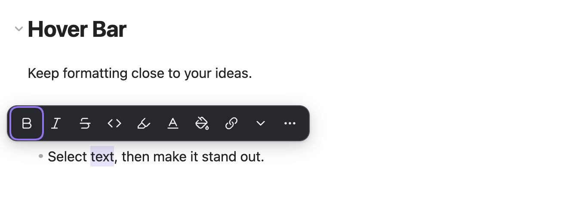

# Hover Bar

轻量、离线的 Obsidian 桌面端选区排版插件。选中文字后，直接完成排版、文字着色、背景着色和双链操作。

[English](README.md)

## 如何使用

阅读笔记时标记重点，整理摘录时调整层次，或把一句话中的概念连接到已有笔记。选中文字后，工具条在附近出现，常用排版可以直接点击完成。

常规格式优先使用 Markdown；从色板选择文字色或背景色时，自动写入简洁的行内 HTML，无需手写颜色标签。

## 功能

- 桌面端完成选区后弹出紧凑胶囊工具条，靠近文字并避开窗格边界。
- 按 vault 固定和排序常用项；未固定或当前窗格放不下的操作仍可从「更多」访问。
- 加粗、斜体、删除线、行内代码和 Obsidian 标准高亮。
- 带名称的文字色与背景色色板、自定义 HEX 输入和预览，以及按 vault 分别保存的最近颜色。
- 一键生成 `[[双链]]`，也可搜索并关联已有笔记。
- 使用编辑器原生撤销和重做，连续改色不叠套标签。
- 适配明暗主题，支持键盘操作。
- Obsidian 设置为中文时显示中文，其他任何语言均显示英文。
- 可关闭自动弹出，保留命令面板手动呼出入口。
- 手动操作会区分只读、模式关闭、多选区、跨行、格式冲突和长度限制，并说明如何继续。

## 使用方法

1. 在实时预览或源码模式中打开 Markdown 笔记。
2. 用鼠标或触控板选中一段普通文字。
3. 点击格式按钮，或打开色板选择颜色。

点击外部或按 Esc 关闭。键盘用户可通过命令面板中的「显示选区工具条」打开工具条，也可在 Obsidian 的快捷键设置中自行绑定快捷键。

| 操作 | 笔记中保存的内容示例 |
| --- | --- |
| 加粗 | `**重点**` |
| 删除线 | `~~过时内容~~` |
| 标准高亮 | `==重点==` |
| 文字颜色 | `重点` |
| 背景颜色 | `重点` |
| 内部链接 | `[[概念]]` |

## 兼容性与限制

需要桌面端 Obsidian **1.8.7 或更高版本**，支持实时预览与源码模式，不支持移动端。阅读视图不提供工具条。

格式操作支持同一逻辑行中的单一文本片段，包括标题、列表项和引用中的文字；请选择文字内容，不包含结构标记。复杂混合格式、部分 HTML 标签跨度、多选区、表格、代码块、数学公式和 YAML 不直接改写；不可用动作会说明原因。

自动划选遇到不支持的内容时安静跳过。需要了解原因时，可通过命令面板手动呼出，或激活不可用动作查看说明。长度保护同时检查原始选区、所在行及修改后的整行；过长时请缩小选区或先拆分段落，不会先写入再中断操作。

颜色以行内 HTML 保存在笔记中。关闭插件不会移除内容，显示效果取决于主题与渲染器，部分导出工具可能移除样式。源码模式会显示标记，实时预览在编辑时也可能露出源码；双链按钮明确输出 wikilink。

## 自定义颜色与最近使用

打开「文字颜色」或「背景颜色」，可选预设色、复用最近颜色，或在「自定义颜色」中输入 `#RGB` / `#RRGGBB`，再点击「应用颜色」。短 HEX 和大写值统一转换为小写六位 HEX，例如 `#abc` → `#aabbcc`。预览只改变面板，应用前不修改正文。不接受其他 CSS 表达式、透明色或渐变。

每类色板分别记住最近 5 个成功应用的颜色，最新在前。从主栏颜色入口复用需要两次激活，入口在「更多」中时需要三次。对已着色文字应用同色为空操作，不调整历史顺序；移除颜色或撤销正文也不清除历史。需要修改笔记时，使用「默认文字颜色」「移除背景颜色」或「移除全部颜色」。

最近颜色保存失败时，正文修改仍成功，可继续排版，并在「设置 → Hover Bar → 最近使用」重试。仅历史发生外部冲突时，暂停保存和偏好修改，但仍可编辑。「重新加载最近颜色」放弃开始前未保存的历史，保留重载期间新成功应用的颜色。「清空最近颜色」清空两类列表，不修改笔记或其他偏好。

明暗主题下色值保持不变，请自行选择可读的组合；任意手写 HTML 样式仍不属于支持的编辑语法。0.1.5 在下一次明确修改或成功应用颜色时将插件数据升级为 schema 3；旧版插件会拒绝该数据并停用工具条。若需降级后恢复旧偏好，请在升级前备份插件的 `data.json`；笔记无需转换。

## 安装

Hover Bar 目前尚未上架社区插件市场，可从 [GitHub Releases](https://github.com/saltcoffee/hover-bar/releases/latest) 安装已打包的插件：

1. 在版本附件中下载 `main.js`、`manifest.json` 和 `styles.css`。
2. 在 vault 的 `.obsidian/plugins/` 目录下新建 `hover-bar` 文件夹，将这三个文件放入其中。
3. 重启 Obsidian，在「设置 → 第三方插件」中启用 **Hover Bar**。

上架社区插件市场后，可直接在 Obsidian 内安装：

1. 打开 Obsidian「设置 → 第三方插件」。
2. 点击「浏览」，搜索 **Hover Bar**。
3. 点击「安装」，然后「启用」。

## 设置与键盘操作

在「设置 → Hover Bar」中，可以控制自动显示、实时预览、源码模式，以及键盘选择后是否自动显示。

在「工具条布局」中，使用「固定」「取消固定」「上移」「下移」配置主栏。自定义列表靠前的操作在窄窗格中优先保留；默认布局优先保留删除线和已激活的基础格式，方便直接取消。「恢复默认布局」保留四项开关，「重置全部偏好」同时恢复开关与布局，两者均保留笔记和最近颜色。

未固定或放不下的操作统一进入「更多」。颜色或笔记选择入口收入「更多」后需要额外一步。色板在窄窗格中自动减少列数；如果可用区域无法放下可操作的控件，请调整窗格或滚动后重试。

通过命令面板中的「Hover Bar：显示选区工具条」手动打开工具条；「Hover Bar：切换自动显示工具条」用于开启或关闭鼠标划选后的自动显示。需要快捷键时，可在「设置 → 快捷键」自行绑定，插件不添加默认快捷键。

界面跟随 Obsidian 的语言设置：中文及中文变体显示简体中文文案，其他任何语言显示英文，无需单独设置语言。

手动打开工具条后，用方向键浏览操作，Enter 或 Space 激活。色板中用 Tab 在最近颜色、预设、HEX 输入、应用和移除颜色之间切换，用方向键浏览各颜色组；HEX 输入框中的 Enter 可应用合法颜色。「返回」或 Esc 逐级退出：从「更多」进入色板或笔记选择时，先回「更多」，再回主栏，最后关闭工具条并返回编辑器。不可用按钮同样可以通过方向键访问并了解原因；激活它只显示说明，不修改正文。搜索笔记或输入 HEX 时，输入法组词的 Enter 不会提前提交操作。

布局修改立即生效并自动保存。保存失败时保留当前布局，可在设置中重试；尚未保存时遇到外部更改，会暂停后续保存。重新加载使用磁盘当前偏好，并放弃未保存的本地调整。

## 隐私

插件完全离线，无账户、无运行时网络请求、无遥测、不访问 vault 之外的文件。笔记选择器仅使用 vault 文件元数据，排版仅修改用户明确操作的选区。

## 反馈与参与

欢迎通过 [GitHub Issues](https://github.com/saltcoffee/hover-bar/issues) 提交使用场景和可复现问题。参与实现前请阅读 [贡献指南](CONTRIBUTING.md)，敏感问题参见 [安全说明](SECURITY.md)。

## 支持开发

Hover Bar为免费插件，如果你愿意支持 Hover Bar 的开发，欢迎自愿打赏，支持后续开发与维护，谢谢。

|  |  |
| :---: | :---: |
|  |  |

## 许可

[MIT](LICENSE) © 2026 gua
